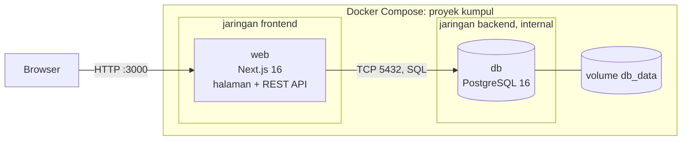
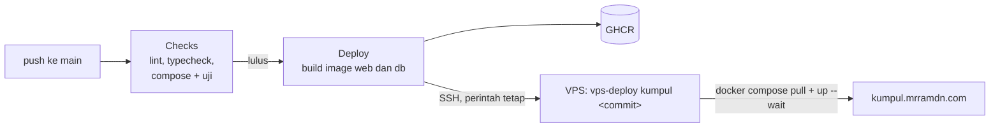

# Kumpul

Aplikasi pendaftaran acara. Siapa pun dapat membuat akun, menerbitkan acara dengan jadwal, lokasi, dan kuota,
lalu mendaftar ke acara lain dengan satu klik.

- Aplikasi: https://kumpul.mrramdn.com
- Dokumentasi API: https://kumpul.mrramdn.com/api/docs
- Status layanan: https://kumpul.mrramdn.com/api/health

Proyek mata kuliah Cloud Services (COMP6991031), checkpoint sebelum UTS.

## Fitur

- Akun pengguna: daftar, masuk, keluar, dan hapus akun. Password disimpan sebagai hash scrypt; sesi disimpan di
  database sehingga keluar benar-benar mencabut sesi.
- Membuat, menampilkan, mengubah, dan menghapus acara. Hanya pemilik acara (atau admin) yang boleh mengubah dan
  menghapusnya.
- Mendaftar ke acara dengan satu klik dan membatalkannya. Kuota, pendaftaran ganda, dan acara yang sudah selesai
  dicek di server. Pemilik acara melihat email peserta dan bisa menghapus peserta.
- Halaman **Acara saya**: acara yang diselenggarakan dan yang diikuti.
- REST API dengan spesifikasi OpenAPI 3.1 dan halaman dokumentasi interaktif di `/api/docs`.
- Validasi input di server dan di database, pemeriksaan kesehatan layanan, dan log JSON per request.
- Dua bahasa (Indonesia dan Inggris) di seluruh halaman, dokumentasi API, dan pesan error; tema terang dan gelap.

## Arsitektur



| Service                               | Image                                                                 | Port di host              | Jaringan              | Volume                                 |
| ------------------------------------- | --------------------------------------------------------------------- | ------------------------- | --------------------- | -------------------------------------- |
| `web`                                 | dibangun dari `Dockerfile` (Node 26, Next.js standalone, user `node`) | `127.0.0.1:3000` → `3000` | `frontend`, `backend` | -                                      |
| `db`                                  | dibangun dari `db/Dockerfile` (`postgres:16-alpine` + skema)          | tidak dibuka              | `backend`             | `db_data` → `/var/lib/postgresql/data` |
| `adminer` (opsional, profile `debug`) | `adminer:4`                                                           | `127.0.0.1:8081` → `8080` | `frontend`, `backend` | -                                      |
| `uji` (profile `test`)                | `node:26.12.0-bookworm-slim`                                          | -                         | `frontend`            | `./tests` (read-only)                  |

**Komunikasi antarlayanan.** Browser hanya berbicara dengan `web` lewat HTTP. Halaman dirender di server dan
langsung membaca database; aksi dari browser (mendaftar, membuat, mengubah, menghapus) memanggil REST API di
`/api/...` pada service yang sama. `web` menghubungi `db` dengan nama service `db` (DNS internal Docker) di port
5432 memakai driver `pg` dan SQL yang ditulis langsung, tanpa ORM.

**Port.** Hanya `web` yang membuka port, dan hanya di `127.0.0.1` (bisa diubah lewat `WEB_BIND`). `db` tidak
punya `ports`, sehingga tidak bisa dihubungi dari luar Docker.

**Jaringan.** `backend` dibuat `internal: true`: container di dalamnya tidak punya akses keluar dan tidak bisa
membuka port. `db` hanya ada di `backend`; `web` ada di `frontend` (untuk port) dan `backend` (untuk database).

**Volume.** Data PostgreSQL disimpan di volume bernama `db_data`, jadi tetap ada saat container dihapus dan dibuat
ulang (`docker compose down` lalu `up`). Hanya `docker compose down -v` yang menghapusnya.

**Skema.** Empat tabel: `users`, `sessions`, `events` (dengan `owner_id`), dan `registrations` (satu akun satu
kali per acara). `db/init/01_schema.sql` (tabel, constraint, indeks) dan `db/init/02_seed.sql` (data contoh)
dijalankan oleh entrypoint PostgreSQL satu kali, saat volume masih kosong. Id memakai UUID supaya alamat acara tidak
bisa ditebak berurutan.

**Healthcheck.** `db` dicek dengan `pg_isready`; `web` baru dijalankan setelah `db` sehat (`depends_on:
condition: service_healthy`). `web` dicek dengan memanggil `/api/health`, yang menjalankan `SELECT 1` ke database
dan membalas 200 atau 503.

**Keamanan.** Password database hanya ada di `.env` (tidak di-commit). Password akun disimpan sebagai hash scrypt
dengan salt acak. Cookie sesi HttpOnly hanya berisi token acak; database menyimpan hash SHA-256-nya. Hak akses
dicek di server: akun lain mendapat 403 saat mencoba mengubah acara yang bukan miliknya. Container web berjalan
sebagai user biasa. Semua query memakai parameter (`$1`, `$2`), bukan teks yang digabung.

## Menjalankan

Prasyarat: Docker Desktop (Windows/macOS) atau Docker Engine dengan Compose v2 (Linux). Node.js tidak dibutuhkan.

```bash
git clone https://github.com/mrramdn/kumpul.git
cd kumpul
cp .env.example .env        # lalu ganti POSTGRES_PASSWORD
docker compose up -d --build
docker compose ps           # db dan web harus (healthy)
```

Buka http://localhost:3000, lalu buat akun lewat menu **Daftar**. Akun contoh dari data awal tidak punya password,
jadi tidak bisa dipakai masuk.

Admin dapat mengubah dan menghapus acara siapa pun, misalnya untuk menghapus spam. Peran ini hanya bisa diberikan
lewat SQL, tidak lewat aplikasi:

```bash
docker compose exec db psql -U kumpul -d kumpul -c "UPDATE users SET is_admin = true WHERE email = 'nama@email.com'"
```

Perintah lain:

```bash
docker compose logs -f web                    # log aplikasi (JSON, satu baris per request)
docker compose --profile debug up -d adminer  # Adminer di http://localhost:8081 (server: db)
docker compose stop                           # berhenti, data tetap
docker compose down                           # hapus container, data tetap di volume
docker compose down -v                        # hapus container dan data (mulai dari nol)
```

Mengembangkan tanpa membangun image (butuh Node.js 26 dan pnpm):

```bash
docker compose -f compose.yaml -f compose.dev.yaml up -d db   # database dibuka di 127.0.0.1:5432
pnpm install
pnpm dev                                                       # http://localhost:3000
```

### Konfigurasi (`.env`)

| Variabel                                            | Fungsi                                                     |
| --------------------------------------------------- | ---------------------------------------------------------- |
| `POSTGRES_DB`, `POSTGRES_USER`, `POSTGRES_PASSWORD` | Database yang dibuat service `db`, dipakai juga oleh `web` |
| `WEB_PORT`, `WEB_BIND`                              | Port dan alamat di host untuk membuka aplikasi             |
| `ADMINER_PORT`                                      | Port Adminer (profile `debug`)                             |
| `APP_ENV`                                           | Label lingkungan yang ditampilkan di `/api/health`         |

## Pengujian

### Otomatis

```bash
docker compose --profile test run --rm uji
```

Menjalankan `tests/api.test.mjs` di container Node terhadap stack yang sedang jalan: 17 tes untuk health,
dokumentasi API dua bahasa, akun (daftar, email ganda, masuk, keluar), validasi, CRUD acara, hak akses pemilik
(403), pendaftaran (login, ganda, kuota, pembatalan), dan acara yang sudah selesai. Tes membuat tiga akun uji dan
menghapusnya lagi di akhir, beserta acaranya.

Workflow **Checks** di GitHub Actions menjalankan lint, typecheck, seluruh stack dengan Docker Compose, tes di atas,
dan uji persistensi pada setiap push dan pull request. Hasil uji lokal ada di [docs/pengujian.md](docs/pengujian.md).

### Skenario demo

**1. Aplikasi berjalan.** `docker compose ps` menunjukkan `db` dan `web` dalam status `(healthy)`, lalu buka
http://localhost:3000.

**2. CRUD.** Buat akun, buat acara, buka detailnya, ubah, lalu hapus. Dengan akun kedua (jendela penyamaran),
daftar ke acara itu dan batalkan lagi. Akun kedua tidak bisa mengubah acara milik akun pertama. Semua endpoint juga
bisa dicoba lewat tombol **Coba** di `/api/docs`.

**3. Persistensi data.**

```bash
docker compose down        # container dihapus, volume db_data tetap
docker compose up -d --wait
```

Akun, acara, peserta, dan bahkan sesi login yang dibuat sebelumnya masih ada.

**4. Input tidak valid.** Kosongkan judul atau isi waktu selesai sebelum waktu mulai di form **Buat acara**. Server
menolak dengan HTTP 400 dan pesan per isian. Lewat terminal:

```bash
curl -s -c cookie.txt -X POST http://localhost:3000/api/session -H 'Content-Type: application/json' \
  -d '{"email":"nama@email.com","password":"password-anda"}'
curl -s -b cookie.txt -X POST http://localhost:3000/api/events -H 'Content-Type: application/json' \
  -d '{"title":"ab","host":"","location":"Lab","startsAt":"2026-11-05T13:00","endsAt":"2026-11-05T12:00"}'
# {"error":{"code":"VALIDATION_ERROR","message":"Terdapat isian yang belum valid.","fields":{"title":"Judul minimal 3 karakter.", ...}}}
```

Contoh lain: mendaftar dua kali (409 `ALREADY_REGISTERED`), kuota penuh (409 `EVENT_FULL`), akun lain mengubah
acara (403 `NOT_EVENT_OWNER`), email akun sudah dipakai (409 `EMAIL_TAKEN`), ID bukan UUID (400 `INVALID_ID`), tanpa
login (401 `UNAUTHORIZED`).

**5. Gangguan layanan dan pemulihan.**

```bash
docker compose stop db
curl -i http://localhost:3000/api/health      # 503 {"status":"error","database":"down",...}
docker compose logs --tail 5 web              # "health check: database tidak bisa dihubungi" ... EAI_AGAIN db
docker compose ps                             # web menjadi (unhealthy) setelah sekitar 30 detik
docker compose start db
curl -i http://localhost:3000/api/health      # 200 lagi, tanpa me-restart web
```

Selama database mati, API membalas 503 `DATABASE_UNAVAILABLE` dalam hitungan milidetik (batas koneksi 3 detik),
halaman menampilkan pesan error dengan tombol **Coba lagi**, dan indikator di footer berubah merah. Setelah
database menyala lagi, koneksi baru dibuat otomatis.

## API

Dokumentasi lengkap dan interaktif ada di `/api/docs`; spesifikasinya di `/api/openapi.json`
([src/lib/openapi.ts](src/lib/openapi.ts)).

| Method            | Path                                              | Keterangan                                                   |
| ----------------- | ------------------------------------------------- | ------------------------------------------------------------ |
| GET               | `/api/health`                                     | Status web dan database (200/503)                            |
| POST              | `/api/users`                                      | Buat akun, langsung masuk                                    |
| DELETE            | `/api/users/me`                                   | Hapus akun sendiri beserta acara dan pendaftarannya          |
| GET, POST, DELETE | `/api/session`                                    | Akun yang sedang masuk, masuk, keluar                        |
| GET               | `/api/me/events`                                  | Acara yang diselenggarakan dan diikuti                       |
| GET               | `/api/events?when=upcoming\|past\|all`            | Daftar acara                                                 |
| POST              | `/api/events`                                     | Buat acara (butuh login)                                     |
| GET               | `/api/events/{id}`                                | Detail acara                                                 |
| PUT               | `/api/events/{id}`                                | Ubah acara (pemilik atau admin)                              |
| DELETE            | `/api/events/{id}`                                | Hapus acara beserta pesertanya (pemilik atau admin)          |
| GET               | `/api/events/{id}/registrations`                  | Daftar peserta (email lengkap hanya untuk pemilik dan admin) |
| POST              | `/api/events/{id}/registrations`                  | Daftar ke acara (butuh login, tanpa body)                    |
| DELETE            | `/api/events/{id}/registrations/{registrationId}` | Batalkan pendaftaran sendiri, atau pemilik menghapus peserta |
| GET               | `/api/openapi.json?lang=id\|en`                   | Spesifikasi OpenAPI 3.1                                      |

Format respons: `{ "data": ... }` untuk sukses, `{ "error": { "code", "message", "fields" } }` untuk gagal. Jam
tanpa zona waktu (`2026-11-05T13:00`) dibaca sebagai WIB. Login memakai cookie HttpOnly `kumpul_session`; dari
terminal pakai `curl -c cookie.txt` untuk menyimpan dan `-b cookie.txt` untuk mengirimnya.

## CI/CD dan deploy



- **Checks** (`.github/workflows/checks.yml`) berjalan pada setiap push dan pull request.
- **Deploy** (`.github/workflows/deploy.yml`) berjalan setelah Checks lulus di `main`: membangun image `web` dan
  `db`, mengirimnya ke GitHub Container Registry, lalu masuk ke VPS lewat SSH. Kunci SSH-nya hanya bisa menjalankan
  satu perintah, `vps-deploy kumpul <commit>`, yang menarik image commit itu dan menjalankan
  `docker compose up -d --wait`.
- Secret deploy disimpan di GitHub Environment `production`, yang hanya boleh dipakai branch `main`.
- Di server, nginx menerima HTTPS (Cloudflare di depan, sertifikat Let's Encrypt) dan meneruskan ke
  `127.0.0.1:3450`. Database tidak punya port di host. nginx membatasi percobaan masuk dan pembuatan akun per
  alamat.

## Struktur folder

```
.
├── compose.yaml            # service db, web, adminer (debug), uji (test); jaringan dan volume
├── compose.dev.yaml        # membuka port database untuk pnpm dev
├── Dockerfile              # image web: deps -> build -> runtime (standalone, user node)
├── .env.example            # contoh konfigurasi, tanpa nilai rahasia
├── db/
│   ├── Dockerfile          # image db: postgres:16-alpine + skema
│   └── init/               # 01_schema.sql, 02_seed.sql
├── src/
│   ├── app/                # halaman (/, /acara/..., /saya, /masuk, /daftar, /tentang, /api/docs) dan route API
│   ├── components/         # komponen antarmuka (design system Raster)
│   ├── i18n/               # teks Indonesia dan Inggris
│   ├── lib/                # koneksi database, query SQL, akun dan sesi, validasi, log, spesifikasi OpenAPI
│   └── proxy.ts            # mengarahkan halaman yang butuh akun ke /masuk
├── tests/api.test.mjs      # uji API
└── .github/workflows/      # Checks dan Deploy
```

## Hubungan dengan materi Week 1–7

| Minggu | Materi                                                       | Penerapan di Kumpul                                                                                                                                                                                                                   |
| ------ | ------------------------------------------------------------ | ------------------------------------------------------------------------------------------------------------------------------------------------------------------------------------------------------------------------------------- |
| 01     | Model layanan cloud, shared responsibility                   | Aplikasi di-deploy ke VPS (IaaS): sistem operasi, Docker, nginx, dan backup menjadi tanggung jawab kami; GHCR dan GitHub Actions dipakai sebagai layanan terkelola                                                                    |
| 02     | Git, Linux, permission, otomasi shell                        | Riwayat Git dan pull request; container berjalan sebagai user non-root; secret di file mode 600 di server; deploy otomatis lewat skrip shell                                                                                          |
| 03     | DNS, HTTP, port, TLS, diagnosis antar tier                   | `kumpul.mrramdn.com` lewat Cloudflare dan TLS di nginx; status HTTP yang tepat (201, 204, 400, 401, 404, 409, 503); `/api/health` dan log untuk diagnosis                                                                             |
| 04     | VM dan container                                             | Aplikasi dan database berjalan sebagai container terpisah di satu host                                                                                                                                                                |
| 05     | Dockerfile dan lifecycle image                               | `Dockerfile` multi-stage (deps, build, runtime) dan image `db` turunan `postgres:16-alpine`; image diberi tag commit di GHCR                                                                                                          |
| 06     | Docker Compose: network, volume, healthcheck, API + database | Jaringan `frontend` dan `backend` (internal), volume `db_data`, healthcheck dan `depends_on`, REST API dengan PostgreSQL                                                                                                              |
| 07     | Skema data, Auth/RLS                                         | Skema `users`, `sessions`, `events`, `registrations` dengan CHECK, UNIQUE, FOREIGN KEY `ON DELETE CASCADE`, dan UUID; akun dengan password scrypt dan sesi di database; otorisasi per pemilik acara (403). RLS direncanakan untuk UAS |

Cache (Redis) dari Lab 06 sengaja tidak dipakai: data kecil dan selalu harus terbaru (sisa kuota), jadi cache
belum memberi manfaat yang sebanding dengan risiko data basi.

## Tim dan kontribusi

| Nama           | NIM | GitHub    | Peran                    | Kontribusi                                                              |
| -------------- | --- | --------- | ------------------------ | ----------------------------------------------------------------------- |
| Nama Anggota 1 | NIM | @username | Infrastruktur dan deploy | Dockerfile, `compose.yaml` (network, volume, healthcheck), CI/CD ke VPS |
| Nama Anggota 2 | NIM | @username | Backend dan database     | Skema PostgreSQL, REST API, validasi, log, dokumentasi OpenAPI          |
| Nama Anggota 3 | NIM | @username | Frontend dan pengujian   | Halaman acara dan form, dua bahasa, uji API dan bukti pengujian         |

Cara berkontribusi: fork repository ini, buat branch, commit dengan identitas Git masing-masing, lalu buka pull
request ke `main`. Checks harus lulus sebelum di-merge; deploy berjalan otomatis setelah merge.

## Rencana sampai UAS

- Row Level Security di PostgreSQL, sehingga aturan "hanya pemilik yang boleh mengubah acaranya" juga dijaga oleh
  database, bukan hanya oleh kode aplikasi.
- Verifikasi email saat membuat akun.
- Migrasi skema bertahap (saat ini skema hanya dijalankan pada volume kosong).
- Metrik latensi p50/p95 dari log request dan pemantauan ketersediaan.
- Backup database terjadwal di server.
