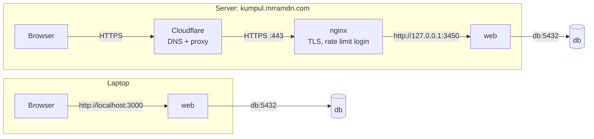
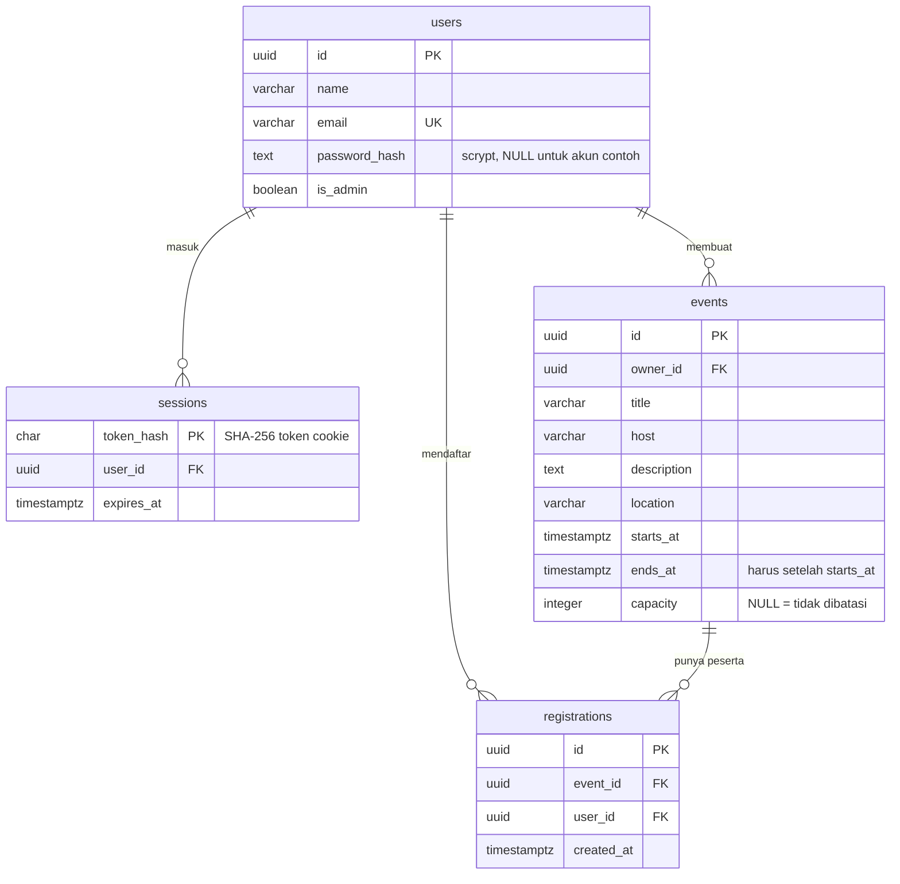

# Arsitektur Kumpul

Ringkasan service, port, dan volume ada di [README](../README.md#arsitektur). Dokumen ini menjelaskan jalur request,
model data, dan alasan di balik pilihan teknisnya.

## Jalur request

Di laptop, browser langsung ke container `web`. Di server, request lewat Cloudflare dan nginx dulu, lalu ke container
yang sama.



`web` adalah satu proses Next.js yang melayani dua hal: halaman (dirender di server, membaca database langsung) dan
REST API di `/api/...` (dipakai browser untuk semua perubahan data). `web` menghubungi `db` lewat nama service `db`
yang di-resolve oleh DNS internal Docker. Port 5432 tidak pernah dibuka ke host.

## Contoh: mendaftar ke acara

```mermaid
sequenceDiagram
  participant B as Browser
  participant W as web (Next.js)
  participant D as db (PostgreSQL)
  B->>W: POST /api/events/{id}/registrations (cookie kumpul_session)
  W->>D: SELECT user FROM sessions JOIN users WHERE token_hash = sha256(cookie)
  D-->>W: akun yang sedang masuk
  W->>D: BEGIN; SELECT ... FROM events WHERE id = $1 FOR UPDATE
  Note over W,D: baris acara dikunci, jadi dua pendaftaran<br/>bersamaan tidak bisa melewati kuota
  W->>D: cek sudah terdaftar, cek kuota, INSERT INTO registrations
  W->>D: COMMIT
  W-->>B: 201 { data: pendaftaran }
  Note over W: satu baris log JSON: method, path, status, durasi
```

Kalau ada aturan yang dilanggar, transaksi dibatalkan dan API membalas 409 (`ALREADY_REGISTERED`, `EVENT_FULL`,
`EVENT_ENDED`). Kalau database tidak bisa dihubungi, pool koneksi menyerah setelah 3 detik dan API membalas 503.

## Model data



Semua foreign key memakai `ON DELETE CASCADE`: menghapus akun ikut menghapus acara, pendaftaran, dan sesinya;
menghapus acara ikut menghapus pesertanya. `UNIQUE (event_id, user_id)` menjaga satu akun hanya terdaftar sekali per
acara, walaupun pengecekan di aplikasi terlewat.

## Keputusan desain

| Keputusan                                   | Alasan                                                                                                                                     |
| ------------------------------------------- | ------------------------------------------------------------------------------------------------------------------------------------------ |
| Halaman dan API dalam satu service Next.js  | Satu image dan satu container lebih sederhana dioperasikan; API tetap terpisah di `/api` dan terdokumentasi, jadi bisa dipakai klien lain. |
| SQL ditulis langsung dengan `pg`, tanpa ORM | Query terlihat apa adanya dan bisa dibaca bersama skemanya; semua nilai tetap lewat parameter `$1`, `$2`.                                  |
| Id UUID                                     | Alamat acara tidak bisa ditebak berurutan (`/acara/1`, `/acara/2`, ...).                                                                   |
| Sesi disimpan di database                   | Keluar benar-benar mencabut sesi, dan sesi tetap berlaku setelah container dibuat ulang.                                                   |
| Jaringan `backend` dibuat `internal`        | Database tidak punya jalan keluar ke internet dan tidak bisa membuka port.                                                                 |
| Tanpa cache (Redis)                         | Data kecil dan sisa kuota harus selalu terbaru; cache belum sebanding dengan risiko data basi.                                             |
| Skema lewat `/docker-entrypoint-initdb.d`   | Cukup untuk sekarang; perubahan skema berikutnya butuh migrasi bertahap.                                                                   |

## Batas keamanan

- Rahasia hanya ada di `.env` (lokal) dan `/srv/kumpul/.env` (server); repository hanya berisi `.env.example`.
- Password akun disimpan sebagai hash scrypt dengan salt acak; cookie sesi HttpOnly hanya berisi token acak.
- Hak akses dicek di server: hanya pemilik acara atau admin yang bisa mengubah dan menghapus, akun lain mendapat 403.
  Peran admin hanya bisa diberikan lewat SQL.
- Email peserta hanya terlihat oleh pemilik acara dan admin.
- Container `web` berjalan sebagai user biasa (`node`), bukan root.
- Di server, nginx membatasi percobaan masuk dan pembuatan akun per alamat.
