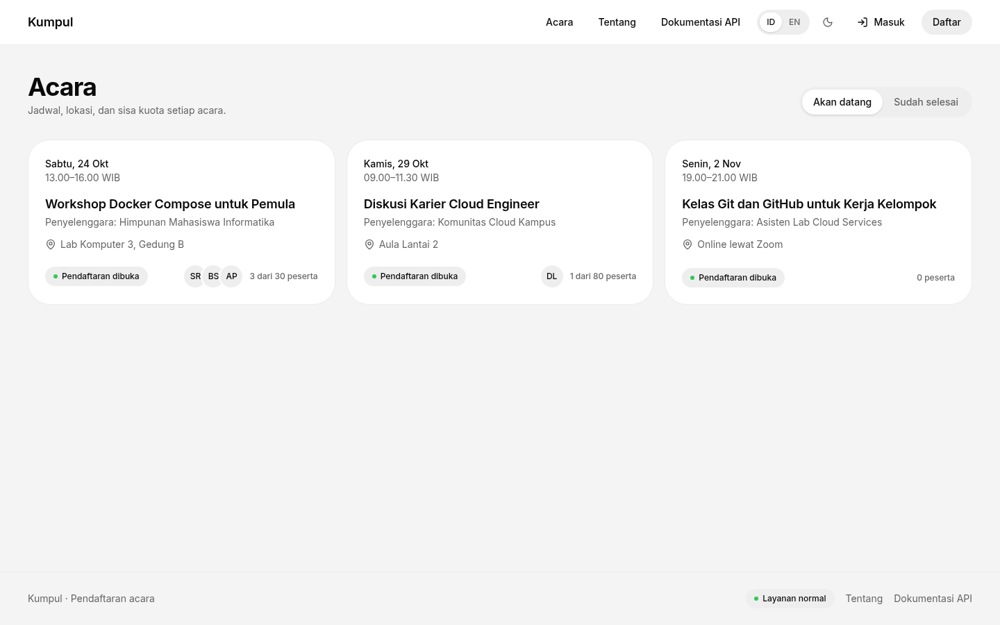
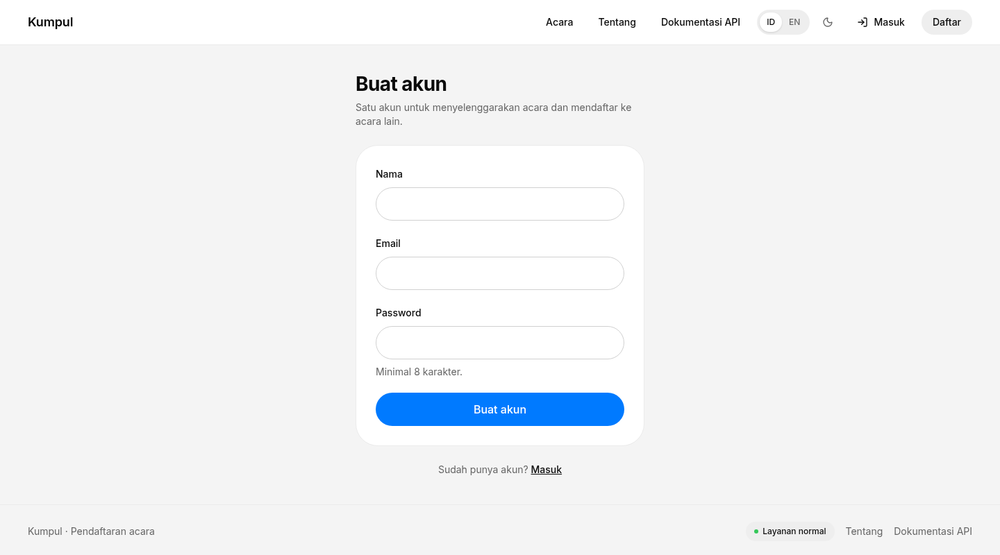
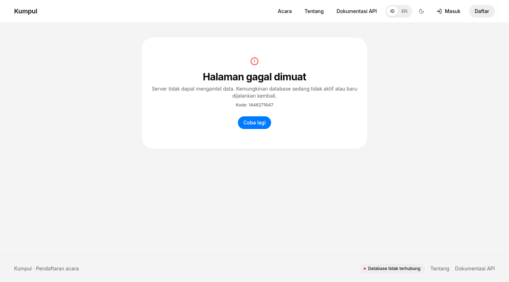
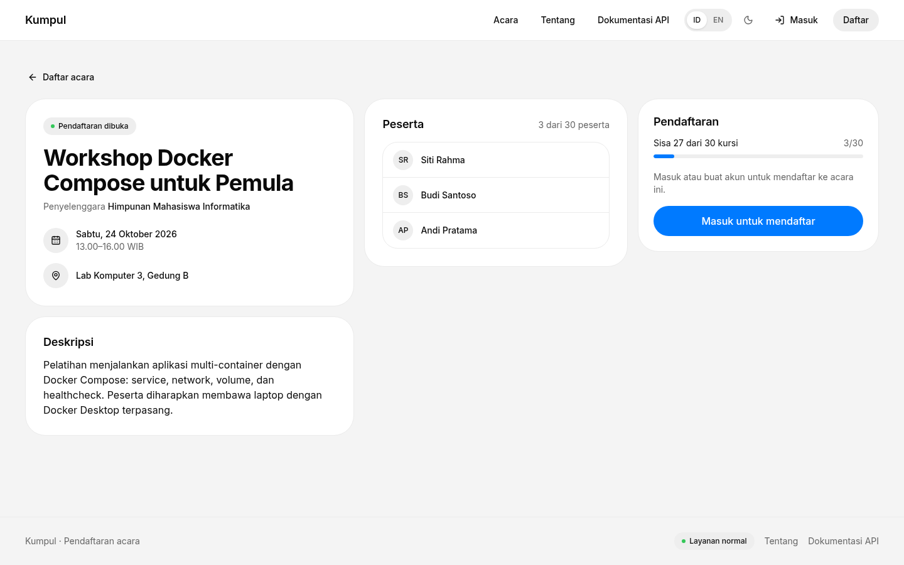
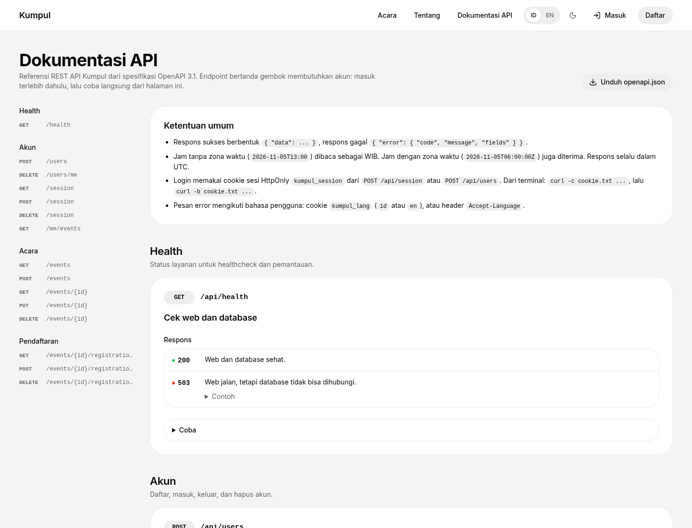
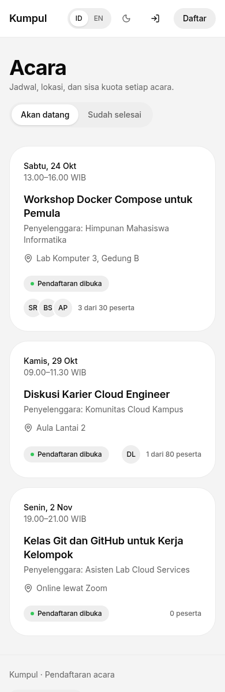

# Bukti pengujian

Dijalankan pada 21 Oktober 2026 di laptop (Linux, Docker Engine 29.9.1, Docker Compose 5.6.0), dari kondisi bersih
(`docker compose down -v`, lalu `docker compose up -d --build --wait`). Akun yang dipakai di bawah adalah akun uji
lokal dan sudah dihapus lagi.

## 1. Stack berjalan

```console
$ docker compose ps
SERVICE   IMAGE        STATUS                    PORTS
db        kumpul-db    Up 55 seconds (healthy)   5432/tcp
web       kumpul-web   Up 45 seconds (healthy)   127.0.0.1:3000->3000/tcp
```

`db` tidak membuka port ke host (`5432/tcp` hanya di dalam jaringan Docker); `web` hanya di `127.0.0.1:3000`.



## 2. Uji API otomatis

```console
$ docker compose --profile test run --rm uji
▶ layanan
  ✔ health: web dan database sehat (28.006118ms)
  ✔ dokumentasi API tersedia dalam dua bahasa (274.326099ms)
✔ layanan (981.094365ms)
▶ akun
  ✔ email disimpan huruf kecil dan tidak bisa dipakai dua kali (204.840106ms)
  ✔ isian akun divalidasi, pesannya ikut bahasa (26.947581ms)
  ✔ masuk, cek sesi, lalu keluar (471.252542ms)
✔ akun (705.669891ms)
▶ acara
  ✔ daftar acara bisa dibaca tanpa login; filter yang tidak dikenal ditolak (53.046366ms)
  ✔ membuat acara butuh login (18.850672ms)
  ✔ input tidak valid ditolak dengan pesan per isian (26.461727ms)
  ✔ waktu selesai harus setelah waktu mulai (25.45853ms)
  ✔ body yang bukan JSON ditolak (21.711587ms)
  ✔ ID yang bukan UUID ditolak, ID yang tidak ada 404 (32.973444ms)
  ✔ CRUD oleh pemilik: buat, baca, ubah, hapus (122.68367ms)
  ✔ akun lain tidak bisa mengubah atau menghapus acara (95.919644ms)
✔ acara (402.301567ms)
▶ pendaftaran
  ✔ mendaftar butuh login, dan hanya sekali per akun (145.491148ms)
  ✔ kuota, email peserta, dan kapasitas (132.239162ms)
  ✔ peserta membatalkan sendiri; akun lain tidak bisa; pemilik bisa menghapus peserta (169.813037ms)
  ✔ pendaftaran ditutup untuk acara yang sudah selesai (41.150168ms)
✔ pendaftaran (490.948348ms)
ℹ tests 17
ℹ suites 4
ℹ pass 17
ℹ fail 0
```

## 3. Akun, input tidak valid, dan hak akses

Membuat akun (cookie sesi disimpan di `cookie.txt`):

```console
$ curl -s -c cookie.txt -X POST http://localhost:3000/api/users -H 'Content-Type: application/json' \
    -d '{"name":"Rina Kusuma","email":"rina@kumpul.test","password":"…"}'
{"data":{"user":{"id":"935fbf46-9b00-4023-9bb6-bfb93a0fc9f4","name":"Rina Kusuma","email":"rina@kumpul.test","isAdmin":false,"createdAt":"2026-10-21T04:48:51.189Z"}}}
HTTP 201
```

Judul terlalu pendek, penyelenggara kosong, dan waktu selesai sebelum waktu mulai:

```console
$ curl -s -b cookie.txt -X POST http://localhost:3000/api/events -H 'Content-Type: application/json' \
    -d '{"title":"ab","host":"","location":"Lab","startsAt":"2026-11-05T13:00","endsAt":"2026-11-05T12:00"}'
{"error":{"code":"VALIDATION_ERROR","message":"Terdapat isian yang belum valid.","fields":{"title":"Judul minimal 3 karakter.","host":"Penyelenggara wajib diisi.","endsAt":"Waktu selesai harus setelah waktu mulai."}}}
HTTP 400
```

Tanpa login, dan akun lain yang mencoba menghapus acara milik Rina:

```console
$ curl -s -X POST http://localhost:3000/api/events -H 'Content-Type: application/json' -d '{"title":"Tanpa login"}'
{"error":{"code":"UNAUTHORIZED","message":"Masuk terlebih dahulu untuk melanjutkan."}}
HTTP 401

$ curl -s -b cookie-bayu.txt -X DELETE http://localhost:3000/api/events/1cb2b577-020a-4486-ba83-2fe95f1ab57a
{"error":{"code":"NOT_EVENT_OWNER","message":"Hanya penyelenggara acara ini yang dapat melakukannya."}}
HTTP 403
```



## 4. Persistensi data

Acara dibuat, semua container dan jaringan dihapus, lalu stack dinyalakan lagi. Volume `db_data` tetap ada: acara
masih bisa dibaca, dan cookie sesi yang sama masih dikenali karena sesi juga disimpan di database.

```console
$ docker compose down
 Container kumpul-web-1 Removed
 Container kumpul-db-1 Removed
 Network kumpul_backend Removed
 Network kumpul_frontend Removed
$ docker volume ls --format '{{.Name}}' | grep kumpul
kumpul_db_data
$ docker compose up -d --wait
 Container kumpul-db-1 Healthy
 Container kumpul-web-1 Healthy

$ curl -s http://localhost:3000/api/events/1cb2b577-020a-4486-ba83-2fe95f1ab57a
{"data":{"id":"1cb2b577-020a-4486-ba83-2fe95f1ab57a","ownerId":"935fbf46-9b00-4023-9bb6-bfb93a0fc9f4","title":"Uji persistensi","host":"Rina Kusuma", ...}}
HTTP 200
$ curl -s -b cookie.txt http://localhost:3000/api/session
{"data":{"user":{"id":"935fbf46-9b00-4023-9bb6-bfb93a0fc9f4","name":"Rina Kusuma","email":"rina@kumpul.test","isAdmin":false,"createdAt":"2026-10-21T04:48:51.189Z"}}}
HTTP 200
```

## 5. Gangguan database dan pemulihan

```console
$ docker compose stop db
$ curl -s http://localhost:3000/api/health
{"status":"error","web":"up","database":"down","environment":"local","uptimeSeconds":9,"time":"2026-10-21T04:49:12.101Z"}
HTTP 503 0.049714s
$ curl -s 'http://localhost:3000/api/events?when=upcoming'
{"error":{"code":"DATABASE_UNAVAILABLE","message":"Database tidak dapat dihubungi. Silakan coba beberapa saat lagi."}}
HTTP 503 0.071138s

$ docker compose ps        # setelah tiga healthcheck gagal
SERVICE   STATUS
web       Up 45 seconds (unhealthy)

$ docker compose logs web --tail 2 --no-log-prefix
{"time":"2026-10-21T04:49:41.422Z","level":"warn","message":"health check: database tidak bisa dihubungi","error":"getaddrinfo EAI_AGAIN db"}
{"time":"2026-10-21T04:49:41.424Z","level":"error","message":"request","method":"GET","path":"/api/health","status":503,"durationMs":9.5}

$ docker compose start db
$ curl -s http://localhost:3000/api/health
{"status":"ok","web":"up","database":"up","databaseLatencyMs":2,"environment":"local","uptimeSeconds":51,"time":"2026-10-21T04:49:54.138Z"}
HTTP 200
$ docker compose ps
SERVICE   STATUS
db        Up 21 seconds (healthy)
web       Up About a minute (healthy)
```

API langsung membalas 503 (sekitar 50–70 ms, tidak menggantung), log menyebut penyebabnya (`EAI_AGAIN db`: nama
service `db` tidak ditemukan karena container-nya mati), healthcheck menandai `web` unhealthy, dan setelah database
menyala lagi semuanya pulih tanpa me-restart `web`. Di browser, halaman menampilkan pesan error dengan tombol
**Coba lagi**, dan indikator di footer berubah merah:



## 6. Log

Satu baris JSON per request, dengan method, path, status, durasi, dan kode error bila ada (contoh dari poin 5 di
atas):

```json
{
  "time": "2026-10-21T04:49:41.424Z",
  "level": "error",
  "message": "request",
  "method": "GET",
  "path": "/api/health",
  "status": 503,
  "durationMs": 9.5
}
```

## Tampilan lain






